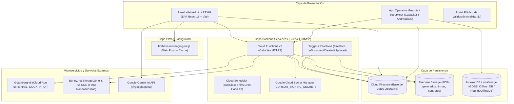

# Arquitectura del Sistema ASPRO (Gestión GGSS Security)

## 1. Visión General del Sistema

ASPRO es una plataforma empresarial híbrida diseñada para la administración y operación integral de empresas de seguridad privada y guardias de seguridad en Chile. El sistema cubre desde la gestión contractual y legal ante la Dirección del Trabajo (DT) y OS-10, hasta la programación de pautas de turnos, marcaje biométrico y GPS de guardias en faenas, rondas de supervisión y portales de cliente mandante.

---

## 2. Componentes de la Arquitectura

### 2.1 Frontend Web & PWA
- **Tecnologías:** React 18, TypeScript, Tailwind CSS, Vite 5, Zustand 5, Lucide React, PDF-Lib.
- **Punto de Entrada:** `index.html` → `index.tsx` → `App.tsx`.
- **Enrutamiento:** Despachador reactivo centralizado en `App.tsx` gobernado por `currentView` y el rol del usuario autenticado en `useAppStore`.
- **Ruta Pública Especial:** `/validar/:validationId` se evalúa antes del guard de autenticación, permitiendo verificar la integridad criptográfica SHA-256 de contratos y documentos sin iniciar sesión.
- **Service Worker Dinámico:** `vite.config.ts` inyecta las credenciales de Firebase en `firebase-messaging-sw.js` durante el build, gestionando Web Push en background.

### 2.2 Aplicación Móvil (Capacitor 8)
- **Tecnologías:** Capacitor 8.3 (`@capacitor/core`, `@capacitor/android`, `@capacitor/ios`).
- **Configuración:** `capacitor.config.ts` (ID: `com.ggss.security`, Nombre: `"Sistema Aspro"`, Assets: `dist`).
- **Plugins Nativos Clave:**
  - `@capacitor-community/background-geolocation`: Foreground service en Android para asegurar seguimiento GPS continuo durante rondas con pantalla apagada.
  - `@capacitor/push-notifications`: Notificaciones push nativas vía FCM.
  - `@capgo/capacitor-updater`: Sistema de actualización de bundle OTA (Over-The-Air) para despliegues transparentes sin reinstalar el APK.
  - `@capacitor/camera` y `@capacitor/geolocation`: Captura de evidencias y geocercas en faena.

### 2.3 Backend y Cloud Functions
- **Runtime:** Node.js 20 en Firebase Functions v2 (`functions/index.js`), estructurado en submódulos dentro de `functions/src/`.
- **Compilación Backend:** Antes del despliegue, `firebase.json` ejecuta `npm run build:backend` para transpolar código TypeScript compartido desde `lib/phase5d2/`.
- **Seguridad Criptográfica:** Uso de `Google Cloud Secret Manager` para inyectar `CURSOR_SIGNING_SECRET` en memoria de las Cloud Functions y firmar con HMAC-SHA256 los cursores de paginación de asistencia.

---

## 3. Modelo de Control de Acceso y Roles (RBAC)

La plataforma aplica segregación estricta de responsabilidades basada en 4 roles primarios definidos en `types.ts`:

1. **`admin` (Administrador General):**
   - Acceso total a las 20 vistas del sistema, finanzas, métricas de dashboard, parametrización de sucursales y emisión contractual.
2. **`supervisor` (Supervisor Operativo en Terreno):**
   - Acceso restringido a `visitas_supervisor`, `rounds`, `notes`, `libro_novedades`.
   - Vistas expresamente bloqueadas en `App.tsx`: `sites`, `tasks`, `shift_management`, `payments`, `loans`, `attendance`.
3. **`worker` (Guardia de Seguridad):**
   - Interfaz operativa única enfocada en `WorkerAttendance.tsx`: marcaje de entrada/salida geolocalizado, ejecución de rondas con checkpoints, libro de incidencias y firma de documentos digitales pendientes.
4. **`mandante` (Cliente Contratante):**
   - Redirigido automáticamente a `MandanteView.tsx`. Vista ejecutiva de solo lectura limitada a las instalaciones y turnos vinculados contractualmente a su empresa.
5. **Sub-roles Operativos:**
   - `rrhh` y `jefe_operaciones`: Reconocidos en `firestore.rules` y Cloud Functions para la gestión y emisión de contratos sin permisos financieros de administración.

---

## 4. Topología de Almacenamiento y Caching

### 4.1 Almacenamiento Remoto
- **Cloud Firestore:** Almacena todos los documentos estructurados, relaciones, estados contractuales y colecciones operativas.
- **Firebase Storage:** Contiene archivos PDF generados (`generated_docs/`), plantillas de contratos maestros (`contract_templates/`) y documentos firmados (`signed_docs/`).
- **Bunny.net Object Storage & CDN:** Almacenamiento de alta capacidad para imágenes y fotografías pesadas (evidencias de rondas y visitas de supervisor). El cliente obtiene URLs presignadas mediante `generateBunnyUploadUrl` y sube los archivos directamente a Bunny sin cargar tráfico a Firebase.

### 4.2 Almacenamiento Local (Offline-First)
- **`GGSS_Offline_DB` (localforage):**
  - Almacena la cola `sync_queue` administrada por `lib/SyncQueueService.ts`.
  - Encola operaciones `CHECK_IN`, `CHECK_OUT`, `ADD_ROUND`, `UPLOAD_EVIDENCE`, `ADD_NOVEDAD`, `ADD_VISITA_SUPERVISOR` cuando no hay conectividad.
- **`RoundsOfflineDB` (IndexedDB Nativo):**
  - Administrado por `lib/roundsDB.ts`.
  - Mantiene los puntos GPS intermedios (`pendingPoints`) y los Blobs binarios de fotografías (`pendingEvidences`) durante una ronda activa. Solo se suben a la nube cuando la ronda se finaliza con éxito.

