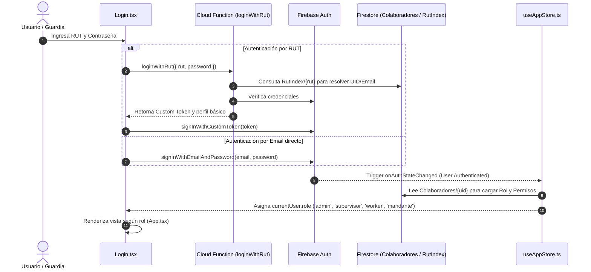
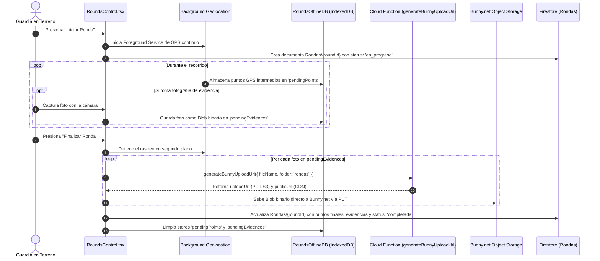
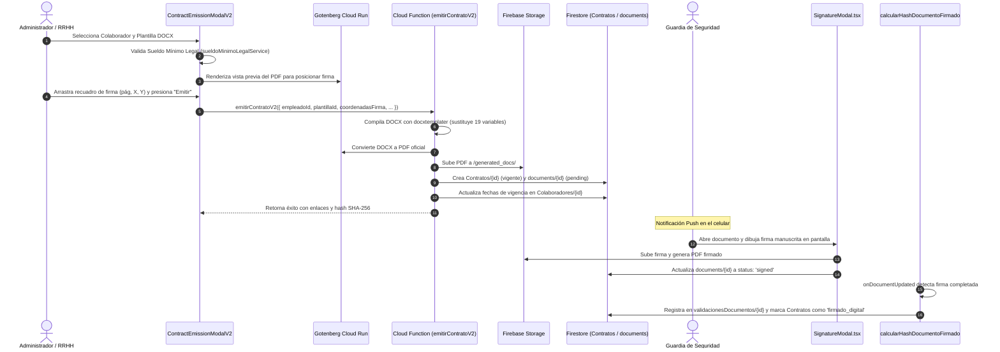

# Flujos Críticos del Sistema ASPRO

Este documento detalla la secuencia operativa paso a paso de los procesos centrales y de mayor sensibilidad del sistema.

---

## 1. Flujo de Autenticación y Resolución de Roles

---

## 2. Flujo de Marcaje de Asistencia y Regla de Turno Nocturno

### 2.1 Regla Obligatoria del Turno Nocturno
> **Regla de Negocio:** Cuando un turno de guardia inicia durante la noche de un día y finaliza durante la mañana del día siguiente (por ejemplo: turno 4x4 o noche regular de **19:30 a 07:30**), toda la jornada laboral y su asistencia **pertenecen y se registran bajo la fecha del día de inicio**. Si el guardia entra el 22 a las 19:30 y sale el 23 a las 07:30, la propiedad `fechaTurno` de ambos marcajes es estrictamente `"2026-10-22"`.

### 2.2 Secuencia de Marcaje
1. El guardia presiona **"Marcar Entrada"** o **"Marcar Salida"** en `WorkerAttendance.tsx`.
2. Se ejecuta `getCurrentPosition()` mediante `@capacitor/geolocation` para obtener latitud y longitud.
3. Se invoca `lib/gpsUtils.ts` para calcular la distancia haversine respecto a la sucursal asignada. Si la distancia excede la geocerca permitida (ej. 300 metros), la app muestra una advertencia visual.
4. **Evaluación de Conectividad:**
   - **Con Conexión:** Se escribe directamente el documento en la colección `Asistencia`. La Cloud Function `shadowAttendanceResolver` procesa el registro y actualiza las pautas de `TurnosDiarios`.
   - **Sin Conexión (Offline):** Se despacha la acción a `lib/SyncQueueService.ts`, la cual genera un `operationId` determinista y lo guarda en `GGSS_Offline_DB` (`localforage`). En cuanto se restablece la red, `SyncManager.ts` vacía la cola sin duplicar registros.

---

## 3. Flujo de Rondas de Seguridad y Captura de Evidencias

---

## 4. Flujo de Emisión y Firma Digital de Contratos V2

---

## 5. Flujo de Actualización en Caliente (OTA) y Forzado de APK

1. **Al iniciar la aplicación móvil (`App.tsx`):**
   - Se invoca `notifyAppReady()` en `lib/UpdateService.ts` para confirmar a `CapacitorUpdater` que el paquete cargó correctamente (evita rollbacks automáticos).
   - Se activa el listener reactivo de versiones en segundo plano `initAutoUpdateListener()`.
2. **Evaluación de la Versión Nativa (APK):**
   - El servicio lee el documento `app_config/version` en Firestore.
   - Si la versión instalada en el dispositivo es menor que `version` y tiene la bandera `mandatory: true`, se bloquea la interfaz con un modal obligatorio que redirige al usuario a descargar el nuevo APK desde la URL provista (`apkUrl`).
3. **Evaluación de la Versión Web OTA:**
   - Si no requiere nuevo APK, pero existe una `webVersion` superior al paquete local:
     - Se verifica si `SyncQueueService.getPending()` tiene elementos por subir. Si hay marcajes pendientes de sincronización, la actualización se pospone para evitar pérdida de datos.
     - Se descarga en segundo plano el archivo `dist.zip` desde `webUrl`.
     - El bundle queda listo y se activa silenciosamente en la próxima apertura de la app.

