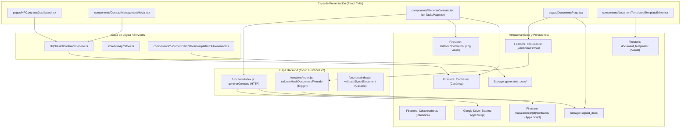
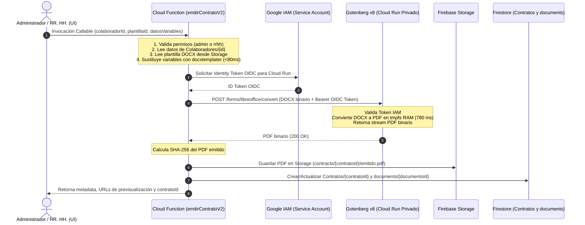

# ASPRO — CONTRATOS V2 — FASE 1C
## Documento de Diseño Técnico: Arquitectura de Plantillas y Emisión Contractual

**Fecha:** 21 de Octubre de 2026  
**Fase:** 1C (Análisis, Diseño y Documentación)  
**Ubicación:** `lab_contratos_v2/DISENO_TECNICO_FASE_1C.md`  
**Estado:** PROPUESTA TÉCNICA AISLADA (Sin cambios en producción)

---

### 1. Resumen Ejecutivo

A partir de los resultados aprobados de las Fases 1A y 1B:
- **Sustitución de variables:** `docxtemplater` + `pizzip` demostraron sustitución exacta y segura en 79 ms con cero tags huérfanos.
- **Conversión a PDF en Linux:** **Gotenberg v8 en Cloud Run** demostró ser la solución técnica óptima (783 ms, 66 KB por contrato, 92 MiB de RAM y 100% fidelidad de paginación de 4 páginas frente a Word COM).

El propósito de la **Fase 1C** es diseñar la arquitectura integral de **Contratos V2** para ASPRO, resolviendo la desconexión existente entre la gestión contractual de RR. HH., el generador legado en Google Drive y el flujo canónico de documentos y firmas digitales.

---

### 2. Auditoría Técnica de la Arquitectura Existente

La inspección exhaustiva de los 16 archivos del repositorio confirmó el siguiente mapa de situación:



#### Hallazgos Críticos de la Auditoría:
1. **Fragmentación de la Colección de Contratos (Hecho verificado):**
   - La colección canónica gobernada por las reglas de seguridad es `Contratos/{id}` (consultada por `HRContractsDashboard.tsx` y validada por `contratosService.ts`).
   - El generador legado (`generarContrato` en `functions/index.js`) escribe en una subcolección no indexada `trabajadores/{colaboradorId}/contratos/{id}`, guardando enlaces de Google Drive.
   - En paralelo, el cliente en `GenerarContrato.tsx` escribe en `HistoricoContratos/{id}` como log visual y luego intenta un `createContrato` en `Contratos` con `googleDriveUrl`.
2. **Aislamiento del Flujo de Firma Digital (Hecho verificado):**
   - El módulo `DocumentsPage.tsx` opera exclusivamente sobre la colección `documents/{docId}` (`DigitalDocument`).
   - Los contratos generados por Google Drive **nunca se insertan en `documents`**, por lo cual los guardias no pueden visualizarlos ni firmarlos en su app móvil o web.
   - Existe ya un campo `Contrato.documentoId` en `types/phase1.ts` y un método `linkDocument` en `contratosService.ts`, pero no existe un flujo automatizado de emisión que cree ambos registros coordinadamente.
3. **Mecanismo de Integridad Existente Robusto (Hecho verificado):**
   - `functions/index.js` implementa el trigger `calcularHashDocumentoFirmado` que calcula SHA-256 sobre `signed_docs/{id}.pdf` y asigna un `validationId: 'ASP-...'`, y la Cloud Function `validateSignedDocument` permite su verificación pública en `/validar/{validationId}` (`pages/ValidacionPage.tsx`).
   - **Decisión arquitectónica:** Contratos V2 debe integrarse de forma nativa con este motor de integridad existente.
4. **Editor Visual EPP (`document_templates`) vs Documentos Extensos (Hecho verificado):**
   - `TemplateEditor.tsx` y `TemplatePDFGenerator.ts` operan mediante bloques secuenciales renderizados por `pdf-lib` en el navegador.
   - Es idóneo para formularios de 1 o 2 páginas (entrega de EPP, inducción ODI), pero carece de motor de paginación de cláusulas legales complejas, tablas multipágina con quiebre de página automático y control de viudas/huérfanas.

---

### 3. Estrategia Híbrida de Plantillas

Para no prometer capacidades inviables en un editor web de bloques ni perder la flexibilidad de Word:

| Tipo de Documento | Motor de Plantilla | Motor de Conversión | Justificación Técnica |
| :--- | :--- | :--- | :--- |
| **Contratos de Trabajo y Anexos Legales** (Extensos, 3 a 6 páginas, cláusulas numeradas, tablas de turnos, personería jurídica) | **Plantilla Maestra DOCX** (`.docx` con sintaxis `{{variable}}`) | **Gotenberg v8 en Cloud Run** | Máxima fidelidad legal, control tipográfico nativo de Word, paginación estricta A4, tablas complejas y firmas alineadas. |
| **Documentos Operacionales y Formularios** (1 a 2 páginas: Entrega EPP, Inducción ODI, Declaraciones simples) | **Editor Visual de Bloques** (`document_templates` existente) | **`pdf-lib` en cliente** (`TemplatePDFGenerator.ts`) | Autonomía del administrador para crear formularios sin requerir Word; ya probado y funcionando en producción. |

---

### 4. Arquitectura de Gotenberg en Cloud Run Privado



#### Especificación de Seguridad de Cloud Run:
- **Despliegue Privado:** Flag `--no-allow-unauthenticated`.
- **Invocador Exclusivo:** Solo la cuenta de servicio de Firebase Functions (`[PROJECT_ID]@appspot.gserviceaccount.com`) posee el rol `roles/run.invoker`.
- **Límites Operacionales:**
  - Memoria: 1 GiB (uso medido en Fase 1B: 92 MiB).
  - CPU: 1 vCPU (suficiente para <800 ms de procesamiento).
  - Concurrencia: 10 peticiones por instancia.
  - Timeout: 60 segundos.
  - Límite de payload: `--api-body-limit=10MB`.
  - Auto-reinicio de LibreOffice: `--libreoffice-restart-after=10` para prevenir fugas de memoria en LibreOffice.

---

### 5. Soporte de Firma Dual (Digital vs Física)

Contratos V2 contemplará dos caminos independientes de firma documental, sin romper la trazabilidad:

```mermaid
flowchart TD
    EMITIDO[Contrato Emitido: PDF Almacenado y Registrado] --> SELECT{Canal de Firma}
    
    SELECT -->|Opción A: Digital ASPRO| DIG_ASSIGN[Asignado a documents/{docId}]
    DIG_ASSIGN --> DIG_PEND[Estado: pendiente_firma]
    DIG_PEND --> DIG_APP[Colaborador firma en App / DocumentsPage]
    DIG_APP --> DIG_STAMP[Estampado pdf-lib + Subida signed_docs/]
    DIG_STAMP --> DIG_HASH[Trigger CF: SHA-256 + validationId]
    DIG_HASH --> DIG_DONE[Contrato: firmado_digital + vigente]

    SELECT -->|Opción B: Física / Notaría| FIS_PRINT[Descargar PDF e Imprimir]
    FIS_PRINT --> FIS_PEND[Estado: pendiente_firma_fisica]
    FIS_PRINT --> FIS_SIGN[Firma manuscrita en papel]
    FIS_SIGN --> FIS_SCAN[Escaneo / Digitalización del documento]
    FIS_SCAN --> FIS_UPLOAD[Admin sube PDF escaneado a Contrato]
    FIS_UPLOAD --> FIS_HASH[Cálculo SHA-256 del escaneado]
    FIS_HASH --> FIS_DONE[Contrato: firmado_externo + vigente]
```

---

### 6. Clasificación Metodológica de Decisiones

| Elemento de Diseño | Hecho Verificado | Propuesta Arquitectónica | Supuesto por Validar |
| :--- | :---: | :---: | :---: |
| Reutilización de `Contratos/{id}` como colección canónica única |  Verificado en `contratosService.ts` y `firestore.rules` |  Propuesta de no crear colecciones paralelas | — |
| Reutilización de `documents/{docId}` para firma digital |  Verificado en `DocumentsPage.tsx` y `functions/index.js` |  Enlace automático 1:1 mediante `Contrato.documentoId` | — |
| Invocación de Gotenberg vía token OIDC de Cloud Functions |  Verificado soporte nativo en `google-auth-library` |  Servicio Cloud Run privado sin IP pública |  Requiere habilitar Cloud Run API en el proyecto GCP |
| Almacenamiento de plantillas DOCX en Firebase Storage | — |  Guardar en `contract_templates/{id}_v{version}.docx` |  Aprobación de almacenamiento por el cliente |
| Solución tipográfica para líneas de firma en Linux |  Verificado que 36 guiones continuos hacen salto en Carlito |  Usar `borderTop` de tabla en lugar de `___` |  Aprobado en Fase 1B |
| Coexistencia temporal con el generador legado Apps Script |  Verificado en `components/GenerarContrato.tsx` |  Mantener pestaña legada hasta validar V2 |  Fecha de retiro definitivo del Apps Script |

---

### 7. Criterio de Cierre de la Fase 1C

Este diseño no ejecuta código en producción ni altera bases de datos. Los detalles de modelo de datos, flujos de estado y matriz de riesgos se desglosan en los documentos complementarios de esta carpeta.
