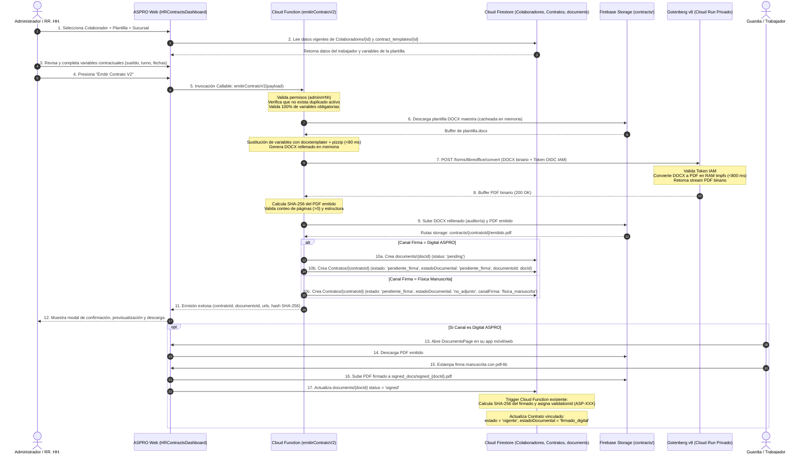
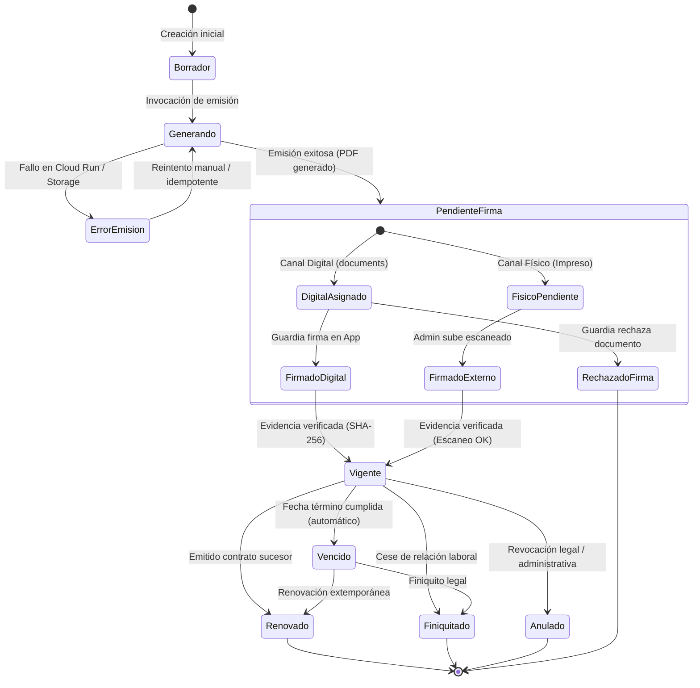
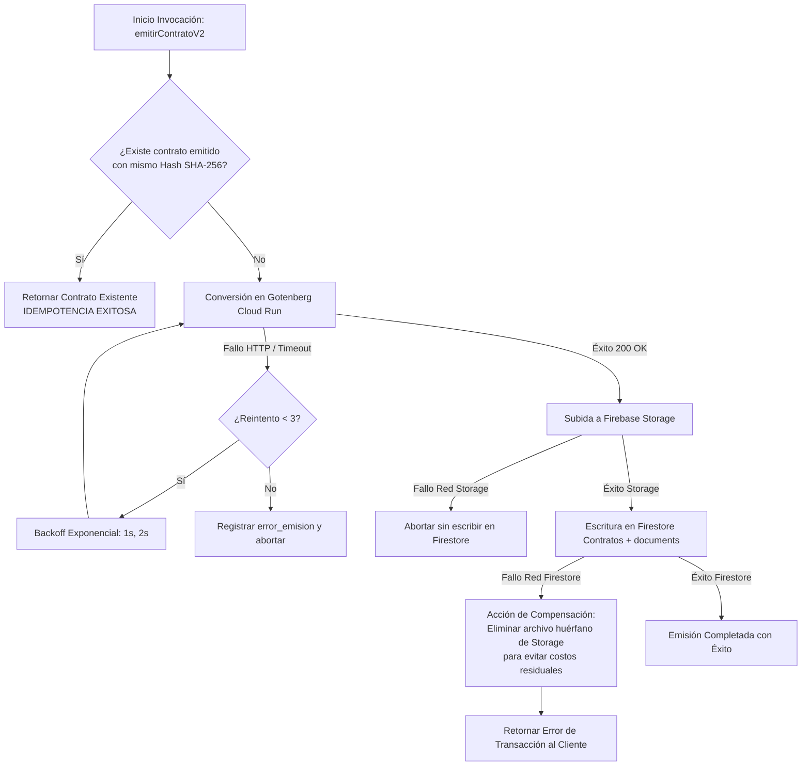

# ASPRO — CONTRATOS V2 — FASE 1C
## Flujo de Emisión Contractual, Estados y Manejo de Errores

**Fecha:** 21 de Octubre de 2026  
**Fase:** 1C (Análisis, Diseño y Documentación)  
**Ubicación:** `lab_contratos_v2/FLUJO_EMISION_CONTRATOS_V2.md`  
**Estado:** PROPUESTA TÉCNICA AISLADA (Sin cambios en producción)

---

### 1. Diagrama de Secuencia del Flujo de Emisión Contractual V2

---

### 2. Detalle de los 11 Pasos del Flujo de Emisión

1. **Selección del Colaborador:**
   - Búsqueda en tiempo real sobre la colección canónica `Colaboradores` por RUT o Nombre.
   - Se muestra el estado operativo actual del colaborador (`en_servicio`, `reserva`, `por_revisar`, `inactivo`).
2. **Selección de Plantilla y Tipo de Contrato:**
   - Selección de la plantilla DOCX activa desde `contract_templates`.
   - Se fija automáticamente la versión inmutable actual de la plantilla (`plantillaVersion`).
3. **Carga y Revisión de Datos Contractuales:**
   - Mapeo automático de los datos personales del colaborador (RUT, Nombre, Dirección, Nacionalidad, Estado Civil, Salud, AFP).
   - Formulario para variables operacionales específicas: Fecha de inicio, fecha de término (obligatoria en plazo fijo), sucursal asignada, cargo, jornada semanal, horario de turnos, sueldo base y asignaciones.
4. **Validación Estricta de Campos Obligatorios:**
   - En cliente y en servidor: Se valida que ninguna variable obligatoria de la plantilla quede vacía o sin resolver.
   - Detección de duplicados: Se invoca la función existente `isDuplicateContract` de `contratosService.ts` para impedir dobles clics o emisiones repetidas accidentales.
5. **Generación del DOCX Rellenado en Memoria:**
   - Ejecución de `docxtemplater` + `pizzip` dentro de la Cloud Function.
   - Se utiliza el parser de variables jerárquicas `{{trabajador.nombre}}` y delimitadores explícitos validados en la Fase 1A.
   - No se escribe en disco temporal; el buffer binario reside exclusivamente en la RAM de la función.
6. **Conversión a PDF en Gotenberg (Cloud Run):**
   - La Cloud Function solicita un Identity Token OIDC a Google IAM y envía el DOCX vía HTTP POST multipart a Gotenberg.
   - Gotenberg procesa la conversión en menos de 800 ms y devuelve el stream binario del PDF.
7. **Validación de Integridad y Cálculo de Hash:**
   - Se calcula el hash criptográfico SHA-256 del PDF emitido (`crypto.createHash('sha256')`).
   - Se verifica que el PDF contenga páginas legibles y formato válido.
8. **Registro Seguro de la Emisión:**
   - El PDF se almacena en Firebase Storage en una ruta inmutable: `contracts/{contratoId}/emitido.pdf`.
   - Se registra el contrato en `Contratos/{contratoId}` con `estadoEmision: 'emitido'`, `pdfSha256`, `plantillaVersion` y `metadataVariablesSnapshot`.
   - **No se sobrescriben contratos previos:** Si es una renovación, se vincula `contratoAnteriorId` y se actualiza el contrato anterior a `estado: 'renovado'` de forma atómica.
9. **Previsualización y Descarga:**
   - La interfaz de ASPRO presenta inmediatamente el visor PDF para verificación visual por parte del administrador.
10. **Elección del Procedimiento de Firma (Dual):**
    - **Vía Digital:** Se crea automáticamente el registro en `documents/{documentoId}`, notificando al trabajador mediante push notification para que firme en su teléfono o portal web.
    - **Vía Física:** El administrador descarga e imprime el PDF para firma física ante notario o en oficina.
11. **Actualización Condicionada a Evidencia:**
    - El contrato NO pasa a `vigente` hasta que exista evidencia comprobada:
      - Si es digital: Cuando `documents/{docId}` pasa a `'signed'` y la Cloud Function registra el hash de la firma.
      - Si es físico: Cuando el administrador sube el PDF escaneado firmado y se calcula su hash correspondiente.

---

### 3. Máquina de Estados de Contratos V2

#### Reglas de Transición de Estados:
1. `borrador` $\rightarrow$ `generando`: Solo iniciable por usuarios con rol `admin` o `rrhh`.
2. `generando` $\rightarrow$ `pendiente_firma`: Exclusivamente ejecutado por la Cloud Function tras recibir código 200 de Gotenberg y confirmar almacenamiento en Storage.
3. `pendiente_firma` $\rightarrow$ `vigente`:
   - En canal digital: Condicionado al evento `status == 'signed'` en `documents/{docId}`.
   - En canal físico: Condicionado a la subida de un archivo PDF válido en `contracts/{id}/firmado_escaneado.pdf`.
4. `vigente` $\rightarrow$ `vencido`: Evaluación dinámica basada en `fechaTermino < hoy` (según función existente `evaluateContractBadge` de `contratosService.ts`).
5. `vigente` $\rightarrow$ `renovado`: Ejecutado de forma coordinada con la creación del nuevo contrato, enlazando `contratoSiguienteId`.

---

### 4. Manejo de Fallos, Reintentos Idempotentes y Recuperación

Dado que Firebase Storage y Cloud Firestore **no comparten una transacción atómica distribuida**, el flujo de emisión contempla la siguiente estrategia de recuperación ante interrupciones:

#### Protocolo de Idempotencia:
- Si el usuario presiona dos veces el botón "Emitir" o la conexión de red oscila:
  1. La Cloud Function genera una clave de idempotencia: `hash(colaboradorId + plantillaId + fechaInicio + fechaTermino)`.
  2. Si ya existe un contrato en proceso (`estadoEmision: 'generando'`) con la misma clave creado hace menos de 60 segundos, se rechaza la solicitud concurrente con código HTTP `409 Conflict`.
  3. Si ya existe un contrato emitido con el mismo hash en la fecha actual, se devuelven los metadatos del contrato existente sin re-ejecutar la conversión en Cloud Run ni crear duplicados en Firestore.

---

### 5. Clasificación Metodológica de Decisiones

| Decisión del Flujo de Emisión | Hecho Verificado | Propuesta Arquitectónica | Supuesto por Validar |
| :--- | :---: | :---: | :---: |
| Sustitución y conversión 100% en backend (Cloud Functions + Cloud Run) |  Probado y medido en Fases 1A y 1B (<800 ms) |  Cero generación en navegador cliente para contratos extensos | — |
| Reutilización del trigger de hash SHA-256 existente |  Confirmado en `functions/index.js:1098` |  Vincular evento a la actualización de `Contratos` | — |
| Mecanismo de compensación de archivos huérfanos en Storage | — |  Borrado reactivo si falla Firestore |  Frecuencia real de fallos de red Storage/Firestore |
| Detección de duplicados e idempotencia |  Existe lógica similar en `contratosService.ts` |  Bloqueo transaccional por hash | — |
| Proceso de firma física con subida de escaneado | — |  Permitir canal `fisica_manuscrita` con hash propio |  Aceptación por el equipo de RR. HH. de ASPRO |
