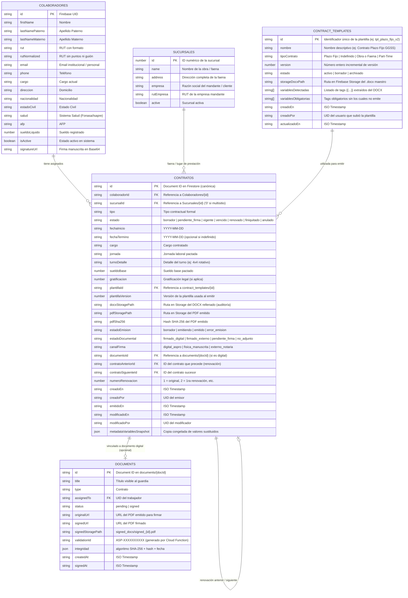

# ASPRO — CONTRATOS V2 — FASE 1C
## Modelo de Datos y Entidades: Contratos V2

**Fecha:** 21 de Octubre de 2026  
**Fase:** 1C (Análisis, Diseño y Documentación)  
**Ubicación:** `lab_contratos_v2/MODELO_DATOS_CONTRATOS_V2.md`  
**Estado:** PROPUESTA TÉCNICA AISLADA (Sin cambios en producción)

---

### 1. Diagrama Entidad-Relación de Contratos V2



---

### 2. Justificación Técnica: Reutilizar `Contratos` vs Crear Colección Paralela

#### Decisión Arquitectónica:
**NO crear una colección nueva o paralela (ej: `ContratosV2` o `ContratosEmitidos`). Reutilizar y extender la colección canónica existente `Contratos`.**

#### Fundamentos Técnicos:
1. **Reglas de Seguridad Consolidadas (Hecho verificado):**
   - En `firestore.rules`, la colección `Contratos/{id}` ya posee control de acceso validado:
     ```
     match /Contratos/{id} {
       allow read: if request.auth != null;
       allow write: if isAdmin() || isRRHH();
     }
     ```
   - Crear una colección paralela duplicaría reglas, aumentaría la superficie de ataque y requeriría actualizar autorizaciones de seguridad.
2. **Servicios y Vistas Existentes (Hecho verificado):**
   - El servicio `contratosService.ts` (`getContratosByColaborador`, `renewContrato`, `linkDocument`, `getActiveContract`, `isDuplicateContract`) ya opera contra `Contratos`.
   - La pantalla `pages/HRContractsDashboard.tsx` ya consume `contratos` desde el store de Zustand apuntando a `Contratos`.
   - El motor de validación de turnos y discrepancias operacionales (Fase 3 / Fase 5) consulta `Contratos` para verificar la cobertura legal del guardia antes de validar una asistencia.
3. **Migración Cero (Hecho verificado):**
   - Los contratos preexistentes en `Contratos` continúan siendo válidos sin necesidad de un script de migración disruptivo.
   - Los contratos emitidos mediante el motor V2 simplemente contarán con nuevos campos opcionales (`plantillaId`, `pdfSha256`, `docxStoragePath`, `estadoEmision`), manteniendo retrocompatibilidad total (`schemaVersion: 2`).

---

### 3. Matriz Detallada de Campos de la Entidad `Contrato`

A continuación se distingue qué campos ya existen en el código y qué campos son incorporados para la emisión V2:

| Campo | Tipo | Estado en Código | Propósito y Definición en Contratos V2 |
| :--- | :--- | :---: | :--- |
| `id` | `string` | **Existente** | ID del documento en Firestore. |
| `colaboradorId` | `string` | **Existente** | UID del trabajador en `Colaboradores/{id}`. |
| `sucursalId` | `string` | **Existente** | ID de la faena/sucursal asignada (`'0'` si multisucursal). |
| `tipo` | `string` | **Existente** | Tipo de contrato (`'Plazo Fijo'`, `'Indefinido'`, `'Obra y Faena'`). |
| `estado` | `EstadoContrato` | **Existente** | Estado operacional: `'borrador'`, `'pendiente_firma'`, `'vigente'`, `'vencido'`, `'renovado'`, `'finiquitado'`, `'anulado'`. |
| `fechaInicio` | `string` | **Existente** | Fecha de inicio pactada (`YYYY-MM-DD`). |
| `fechaTermino` | `string?` | **Existente** | Fecha de término pactada (`YYYY-MM-DD`). Obligatoria en plazo fijo. |
| `cargo` | `string?` | **Existente** | Cargo estipulado en el contrato (ej: Guardias de Seguridad OS-10). |
| `jornada` | `string?` | **Existente** | Jornada laboral pactada (ej: `45 horas semanales`). |
| `googleDriveUrl` | `string?` | **Existente (Legacy)** | Enlace a Google Drive. Se mantiene sólo para lectura de contratos históricos. |
| `documentoId` | `string?` | **Existente** | Referencia al documento en `documents/{docId}` para firma digital. |
| `estadoDocumental` | `EstadoDocumental` | **Existente** | `'firmado_digital'`, `'firmado_externo'`, `'pendiente_firma'`, `'no_adjunto'`. |
| `observacionesDocumento` | `string?` | **Existente** | Notas administrativas sobre el documento físico o digital. |
| `origenRegistro` | `OrigenRegistroContrato`| **Existente** | Origen: se utilizará `'emision_sistema'` para contratos generados por V2. |
| `contratoAnteriorId` | `string?` | **Existente** | Trazabilidad: ID del contrato renovado previamente. |
| `contratoSiguienteId` | `string?` | **Existente** | Trazabilidad: ID del nuevo contrato que reemplazó a este. |
| `numeroRenovacion` | `number` | **Existente** | Contador de renovaciones (`1` = contrato original). |
| `fechaFirmaReal` | `string?` | **Existente** | Fecha real de firma física si difiere de la fecha de emisión. |
| `creadoEn` | `string` | **Existente** | Timestamp ISO de creación del registro. |
| `creadoPor` | `string` | **Existente** | UID del usuario responsable. |
| `modificadoEn` | `string?` | **Existente** | Timestamp ISO de la última modificación. |
| `modificadoPor` | `string?` | **Existente** | UID del último modificador. |
| `schemaVersion` | `number?` | **Existente** | Versión de esquema (`2` para Contratos V2). |
| **`plantillaId`** | `string` | **NUEVO V2** | ID de la plantilla maestra utilizada (`contract_templates/{id}`). |
| **`plantillaVersion`** | `number` | **NUEVO V2** | Versión inmutable de la plantilla con la que se emitió el documento. |
| **`docxStoragePath`** | `string?` | **NUEVO V2** | Ruta en Storage del archivo Word generado (`contracts/{id}/rellenado.docx`). Permite auditoría exacta. |
| **`pdfStoragePath`** | `string` | **NUEVO V2** | Ruta en Storage del PDF emitido (`contracts/{id}/emitido.pdf`). |
| **`pdfSha256`** | `string` | **NUEVO V2** | Hash criptográfico SHA-256 del PDF emitido por Gotenberg antes de firmar. |
| **`estadoEmision`** | `string` | **NUEVO V2** | Estado del proceso de emisión: `'borrador'`, `'generando'`, `'emitido'`, `'error_emision'`. |
| **`canalFirma`** | `string` | **NUEVO V2** | Canal acordado de firma: `'digital_aspro'`, `'fisica_manuscrita'`, `'externo_notaria'`. |
| **`sueldoBase`** | `number?` | **NUEVO V2** | Sueldo base en pesos chilenos estipulado en la cláusula de remuneración. |
| **`gratificacion`** | `number?` | **NUEVO V2** | Gratificación legal 25% (art. 50 Código del Trabajo) pactada. |
| **`turnoDetalle`** | `string?` | **NUEVO V2** | Descripción del turno asignado (ej: `Turno 4x4 rotativo diurno/nocturno`). |
| **`metadataVariablesSnapshot`**| `json?` | **NUEVO V2** | Copia congelada de todas las variables reemplazadas en la plantilla, garantizando inmutabilidad legal. |

---

### 4. Nueva Colección: `contract_templates` (Plantillas Contractuales)

Para gestionar las plantillas DOCX maestras sin modificar las plantillas de formularios visuales (`document_templates`):

```typescript
export interface ContractTemplate {
  id: string; // ej: "tpl_ggss_plazo_fijo"
  nombre: string; // "Contrato Individual de Trabajo Plazo Fijo — GGSS"
  tipoContrato: 'Plazo Fijo' | 'Indefinido' | 'Obra y Faena' | 'Part-Time';
  version: number; // 1, 2, 3...
  estado: 'activo' | 'borrador' | 'archivado';
  storageDocxPath: string; // "contract_templates/tpl_ggss_plazo_fijo_v2.docx"
  variablesDetectadas: string[]; // ["trabajador.nombre", "contrato.sueldoBase", ...]
  variablesObligatorias: string[]; // Variables críticas requeridas para emitir
  descripcion?: string;
  creadoEn: string; // ISO String
  creadoPor: string; // UID del administrador
  actualizadoEn?: string;
}
```

#### Regla de Inmutabilidad de Versiones:
- Cuando un administrador edita o sube una nueva versión de una plantilla DOCX, **no se sobrescribe la versión anterior**.
- Se incrementa `version = version + 1` y se almacena en una ruta nueva: `contract_templates/{id}_v{version}.docx`.
- Los contratos ya emitidos conservan su referencia exacta (`plantillaId` y `plantillaVersion`). Esto garantiza que una modificación futura de la plantilla no altere la evidencia legal de contratos emitidos en el pasado.

---

### 5. Clasificación Metodológica de Decisiones

| Decisión sobre el Modelo de Datos | Hecho Verificado | Propuesta Arquitectónica | Supuesto por Validar |
| :--- | :---: | :---: | :---: |
| Reutilización de `Contratos/{id}` como colección única |  Confirmado en código y reglas |  Se evita fragmentación de colecciones | — |
| Coexistencia de `Contratos` con `documents/{docId}` |  Confirmado en `linkDocument` de `contratosService.ts` |  Vinculación automática 1:1 en emisión | — |
| Nueva colección `contract_templates` para DOCX maestras | — |  Aísla plantillas DOCX del editor visual EPP |  Aprobación de estructura en Storage |
| Inclusión de `pdfSha256` en el contrato emitido |  Mecanismo probado en `functions/index.js` |  Cálculo de hash previo a la firma | — |
| Campo `metadataVariablesSnapshot` para inmutabilidad | — |  Garantiza auditoría contra cambios en la ficha del trabajador |  Tamaño en bytes promedio por contrato (<5 KB) |
