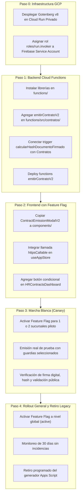

# ASPRO — CONTRATOS V2 — FASE 4
## Plan de Integración Controlada y Rollout en Producción

**Fecha:** 21 de Octubre de 2026  
**Fase:** 4 (Auditoría de Compatibilidad e Integración Controlada)  
**Ubicación:** `lab_contratos_v2/PLAN_INTEGRACION_CONTROLADA.md`  
**Estado:** PROPUESTA DE INTEGRACIÓN POR PASOS (Sin ejecución en producción)

---

### 1. Principios Rectores del Plan de Integración

1. **Cero Tiempo de Inactividad (Zero-Downtime):** Ningún paso del despliegue puede interrumpir la operación actual de los guardias, el marcaje de asistencia ni la gestión de contratos existente.
2. **Coexistencia y Fallback Inmediato:** El generador legado de Google Apps Script (`components/GenerarContrato.tsx`) se mantendrá operativo y accesible como opción de respaldo durante todo el período de marcha blanca.
3. **Activación Progresiva vía Feature Flag:** El nuevo modal y backend se desplegarán en modo inactivo (`disabled`) y luego canario (`canary`), gobernado centralizadamente en `app_config/feature_flags.contratosV2`.
4. **Idempotencia y Compensación Transaccional:** Cada emisión cuenta con deduplicación por hash SHA-256 y compensación reactiva de archivos en Storage para prevenir inconsistencias.

---

### 2. Identificación Expresa de Archivos Productivos a Modificar

Para ejecutar la integración en una fase posterior autorizada, se intervendrán únicamente los siguientes archivos:

| Archivo Productivo | Tipo de Cambio Requerido | Justificación Técnica |
| :--- | :--- | :--- |
| `functions/package.json` | Agregar dependencias | Incorporar `docxtemplater`, `pizzip`, `pdf-lib` y `google-auth-library`. |
| `functions/src/contratos/emitirContratoV2.js` | **NUEVO ARCHIVO** | Lógica validada de la Cloud Function Callable para emisión e integración Gotenberg. |
| `functions/index.js` | Exportar función y trigger | Exportar `emitirContratoV2` y añadir hook de actualización en `calcularHashDocumentoFirmado`. |
| `types/phase1.ts` | Extensión de interfaz | Incorporar campos opcionales V2 (`plantillaId`, `pdfSha256`, `canalFirma`, etc.) a `Contrato`. |
| `components/ContractEmissionModalV2.tsx` | **NUEVO ARCHIVO** | Trasladar el componente probado desde `lab_contratos_v2/ui/` hacia `components/`. |
| `pages/HRContractsDashboard.tsx` | Adición de botón con Feature Flag | Añadir botón "Emitir Contrato V2" junto al botón legado, condicionado a Feature Flag. |
| `store/useAppStore.ts` | Soporte de Feature Flag | Leer el estado de `featureFlags.contratosV2` desde Firestore. |

*Nota: Ningún archivo listado ha sido modificado durante esta fase.*

---

### 3. Fases Secuenciales de Integración



---

### 4. Detalle Paso a Paso de la Integración

#### Paso 0: Provisión del Microservicio en Cloud Run Privado
- **Comando de despliegue sugerido:**
  ```bash
  gcloud run deploy gotenberg \
    --image=gotenberg/gotenberg:8 \
    --platform=managed \
    --region=us-central1 \
    --no-allow-unauthenticated \
    --memory=1Gi \
    --cpu=1 \
    --min-instances=0 \
    --max-instances=5 \
    --concurrency=10 \
    --timeout=60s \
    --args="--api-body-limit=10MB,--libreoffice-restart-after=10"
  ```
- **Asignación de permisos IAM:**
  ```bash
  gcloud run services add-iam-policy-binding gotenberg \
    --region=us-central1 \
    --member="serviceAccount:[PROJECT_ID]@appspot.gserviceaccount.com" \
    --role="roles/run.invoker"
  ```
- **Criterio de éxito:** Gotenberg responde HTTP 200 al recibir un token de identidad OIDC de la cuenta de servicio de Firebase. En reposo escala a 0 instancias (costo $0 USD).

#### Paso 1: Backend en Firebase Cloud Functions
1. Añadir en `functions/src/contratos/emitirContratoV2.js` el módulo validado en laboratorio.
2. Inyectar la URL de Cloud Run mediante variable de entorno parametrizada (`params.defineString('GOTENBERG_URL')`).
3. En `functions/index.js:1098` (`calcularHashDocumentoFirmado`), agregar la actualización atómica del contrato vinculado:
   ```javascript
   // Si el documento tiene un contratoId asociado, actualizar el contrato a 'vigente'
   if (after.contratoId) {
     await admin.firestore().collection('Contratos').doc(after.contratoId).update({
       estado: 'vigente',
       estadoDocumental: 'firmado_digital',
       pdfFirmadoSha256: hash,
       validationId: validationId,
       fechaFirmaReal: admin.firestore.FieldValue.serverTimestamp()
     });
   }
   ```
4. Desplegar únicamente las funciones de contratos sin tocar el resto del backend:
   ```bash
   firebase deploy --only functions:emitirContratoV2,functions:calcularHashDocumentoFirmado
   ```

#### Paso 2: Integración de la Interfaz con Feature Flag
1. Copiar `ContractEmissionModalV2.tsx` a `components/ContractEmissionModalV2.tsx`.
2. En `pages/HRContractsDashboard.tsx`, verificar el Feature Flag:
   ```tsx
   const { featureFlags } = useAppStore();
   const isV2Enabled = featureFlags?.contratosV2 === 'active' || 
     (featureFlags?.contratosV2 === 'canary' && canaryBranches.includes(selectedBranch));

   {isV2Enabled && (
     <button 
       onClick={() => setShowEmissionV2Modal(true)}
       className="px-4 py-2 bg-indigo-600 hover:bg-indigo-700 text-white rounded-lg flex items-center gap-2"
     >
       <FileText className="w-4 h-4" />
       Emitir Contrato V2
     </button>
   )}
   ```
3. Mantener el botón existente del generador en `components/GenerarContrato.tsx` accesible en todo momento.

#### Paso 3: Marcha Blanca Controlada (Canary)
- Configurar en Firestore `app_config/feature_flags`:
  ```json
  {
    "contratosV2": "canary",
    "canaryBranches": ["1", "5"],
    "updatedAt": "2026-10-21T00:00:00Z"
  }
  ```
- Emitir contratos de prueba para 2 a 5 guardias reales en las sucursales piloto.
- Verificar el ciclo completo:
  1. Emisión en modal (<1.2 segundos).
  2. Notificación en app del guardia en `DocumentsPage.tsx`.
  3. Firma manuscrita en pantalla y estampado en la página 4.
  4. Activación automática del contrato en `HRContractsDashboard.tsx`.
  5. Verificación pública del certificado en `/validar/{validationId}`.

#### Paso 4: Despliegue General y Transición Definitiva
- Cambiar Feature Flag a `"active"` para todas las sucursales.
- Período de observación de 30 días con métricas de estabilidad.
- Concluida la observación, programar el apagado del script de Google Drive.

---

### 5. Plan de Contingencia y Rollback Inmediato

Si durante la marcha blanca se detecta alguna anomalía:

1. **Reversión Inmediata de UI (Tiempo de respuesta: <1 minuto):**
   - Cambiar en Firestore `app_config/feature_flags.contratosV2 = 'disabled'`.
   - Inmediatamente el botón V2 desaparece de la interfaz de todos los usuarios sin necesidad de hacer un redeploy de código.
2. **Reversión de Backend:**
   - La función legada `generarContrato` y el componente `GenerarContrato.tsx` continúan funcionando sin interrupción.
3. **Preservación de Datos:**
   - Los contratos emitidos bajo V2 durante la prueba permanecen válidos en `Contratos` y los documentos firmados en `documents` conservan su validez legal y criptográfica.
